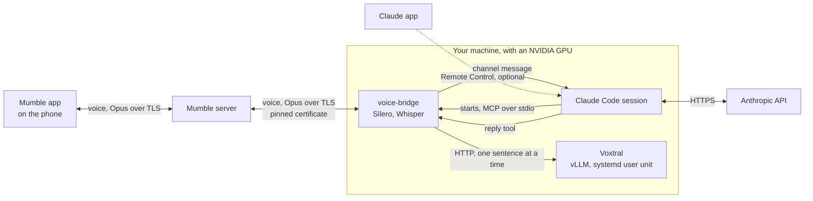
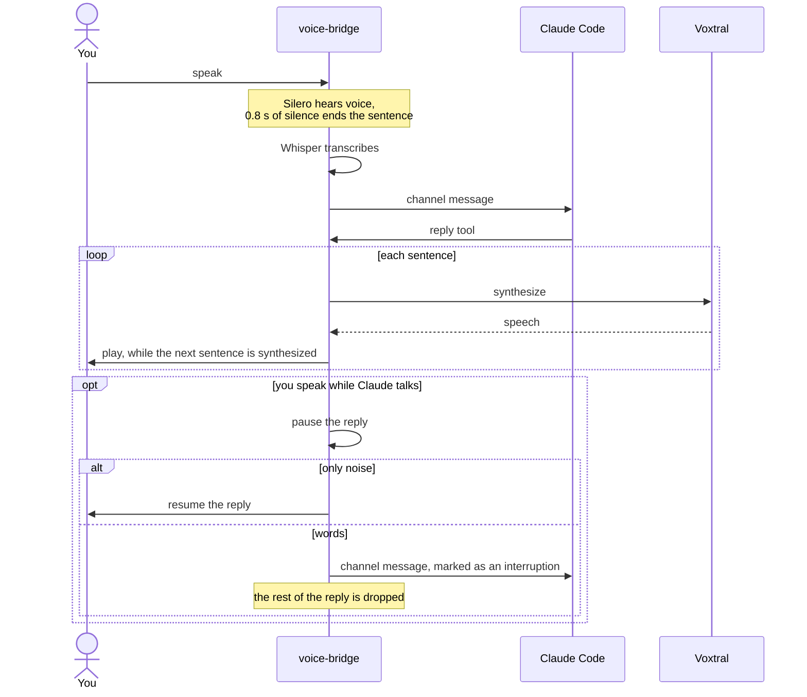
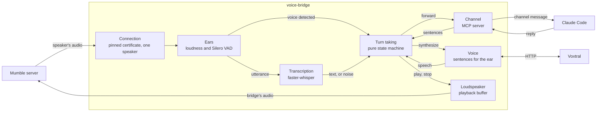

# voice-bridge

Talk to a [Claude Code](https://code.claude.com) session from your phone, hands-free and without looking at a screen. You speak in a Mumble app; the bridge transcribes what you say, hands it to Claude Code as a [channel](https://code.claude.com/docs/en/channels-reference) message, and reads Claude's replies back into your headset. Everything but the Claude model itself runs on your own machines.

## How it works



1. **Your Mumble app** sends your voice to a Mumble server.
2. **The bridge** listens to one person only: the user whose client certificate matches `speaker_certificate_hash`. A sound counts as voice when it is loud enough and [Silero VAD](https://github.com/snakers4/silero-vad) recognises speech in it, so a loud noise alone is neither transcribed nor taken for an interruption. About 0.8 s of silence ends a sentence.
3. **Whisper**, through [faster-whisper](https://github.com/SYSTRAN/faster-whisper) on the GPU, transcribes the sentence.
4. **The `voice` channel** pushes the text into the Claude Code session.
5. **Claude** answers with the `reply` tool, and **[Voxtral](https://huggingface.co/mistralai/Voxtral-4B-TTS-2603)** speaks the answer, sentence by sentence, while the next ones are synthesized.

Speaking while Claude talks cuts its voice: the bridge pauses the reply. If what interrupted was only noise, the reply resumes; if you said something, the rest of the reply is dropped and your words reach Claude marked as an interruption. Claude's work in progress goes on either way.



## Requirements

- Linux with an NVIDIA GPU able to hold Voxtral and Whisper together, about 14 GB of video memory.
- [uv](https://docs.astral.sh/uv/). It brings Python 3.14 and the CUDA libraries the project needs.
- A Mumble server, version 1.5 or later. Voice reaches the bridge through the server's TLS connection, which [pymumble-rev](https://github.com/AidenOfficial/PyMumble) requires.
- A Mumble app on the phone, such as [Mumla](https://mumla-app.gitlab.io/) on Android.
- Claude Code with channels enabled. Channels are a research preview: a channel outside Anthropic's allowlist loads with `--dangerously-load-development-channels`, which the launcher passes.
- [Graphviz](https://graphviz.org/), only to draw the architecture diagram.

## Install

```bash
uv sync
```

## Configure

The bridge reads `~/.config/voice-bridge/config.toml`; `--config` points at another file. Variables named `VOICE_BRIDGE_<KEY>`, or `VOICE_BRIDGE_<SECTION>__<KEY>` for a key inside a section, override the file. An unknown key or a missing value stops the bridge at start. Start from [`config.example.toml`](config.example.toml) and keep the file readable by you only, since it holds the server password:

```bash
mkdir -p ~/.config/voice-bridge
cp config.example.toml ~/.config/voice-bridge/config.toml
chmod 600 ~/.config/voice-bridge/config.toml
```

| Key | Default | Meaning |
|---|---|---|
| `language` | `en` | `en` or `fr`: the language Whisper transcribes, the default voice, the greeting and the default instructions |
| `mumble.host`, `mumble.port` | required, `64738` | The Mumble server |
| `mumble.password` | required | The server password |
| `mumble.username` | `claude` | The bridge's name on the server |
| `mumble.server_certificate` | required | The server certificate the bridge trusts; see below |
| `mumble.speaker_certificate_hash` | required | The certificate hash of the one person the bridge listens to; see below |
| `voxtral.url` | `http://127.0.0.1:8123` | The Voxtral server |
| `voxtral.voice` | the language's | A Voxtral voice, such as `neutral_female` or `fr_female` |
| `voxtral.gain` | `1.0` | Loudness of the speech; values above 1 raise it without clipping |
| `whisper.model`, `whisper.device`, `whisper.compute_type` | `large-v3-turbo`, `auto`, `default` | The faster-whisper model and how it runs |
| `hearing.*` | see [`settings.py`](src/voice_bridge/configuration/settings.py) | Thresholds and durations of voice detection; the start stops when `shortest_voice` exceeds `barge_in`, or when `barge_window` reaches `silence` plus `barge_in`, since an interruption could then be dismissed as too short |
| `instructions_file` | `~/.config/voice-bridge/instructions.md` | What Claude is told about the channel; when the file is missing, the language's defaults from [`instructions/`](src/voice_bridge/configuration/instructions) apply |
| `log_file` | `~/.local/state/voice-bridge/log/voice-bridge.log` | The bridge's log, rotated at 5 MB |

### The server certificate

The bridge trusts one certificate only: the server's, pinned like a known SSH host. It refuses anything older than TLS 1.2, and skips the host name check that a self-signed Murmur certificate cannot pass. Export the certificate once, and again whenever the server generates a new one:

```bash
openssl s_client -connect voice.example.org:64738 </dev/null 2>/dev/null \
  | openssl x509 -outform PEM > ~/.config/voice-bridge/server.pem
```

### The speaker's certificate

A Mumble user name proves nothing: anyone with the server password can take it. The bridge only listens to the client certificate your Mumble app holds. To find its hash, start the bridge with any value, connect from your phone and say something: the bridge ignores you and logs the hash to copy into `speaker_certificate_hash`.

```
ignored a transmission from 'you', certificate hash 6f0b58787b96ff978ba512c74a1c3ca4aabab441
```

## Run

From the folder you want Claude Code to work in:

```bash
~/path/to/voice-bridge/scripts/claude-voice.sh
```

The launcher starts Voxtral when it is not running, which takes a few minutes the first time, then starts Claude Code with the `voice` channel. Arguments go to Claude Code, so `--resume <session>` works.

1. **Accept the warning.** Claude Code shows a full-screen warning about development channels at every start: choose *I am using this for local development*. Below the banner, `Channels (experimental) messages from server:voice` confirms the channel is registered.
2. **Connect from the phone.** Once Whisper is loaded and Voxtral answers, you hear the greeting and the bridge's user appears in the channel.
3. **Optionally, turn on Remote Control** with `/remote-control`. The voice does not need it, but it lets you see the session and answer permission prompts from the Claude app; without it, Claude waits silently when it needs a permission.

While it runs:

- Wear headphones: otherwise the microphone hears Claude and Claude cuts itself off.
- Keep the machine awake; a laptop closing its lid goes to sleep.
- Run one voice session at a time: two bridges with the same name on the server push each other off.

To stop, leave Claude Code with `/exit`, then free the GPU from Voxtral:

```bash
scripts/voxtral.sh stop
```

`scripts/voxtral.sh` also takes `start`, `status` and `logs`; it runs Voxtral with [vLLM](https://docs.vllm.ai) as a systemd user unit.

## Diagnose

The log tells every step of a turn, timestamped to the millisecond: what was heard with Whisper's scores per segment, what was forwarded to Claude, when its reply arrived, how long each sentence took to synthesize, when playback started, how fast an interruption stopped it, and every stall of more than 100 ms in the audio reaching the bridge.

```bash
tail -f ~/.local/state/voice-bridge/log/voice-bridge.log
```

Two more commands help test the voice path without Claude:

- `scripts/with-cuda.sh uv run voice-bridge-rehearsal` joins the server as `rehearsal` and repeats everything you say: hearing, transcription, synthesis and interruptions, without a Claude Code session.
- `uv run voice-bridge-recorder` joins as `recorder` and records the bridge's voice as the server sends it: one WAV per answer in `~/.local/state/voice-bridge/log/recordings/`, and for each one its length, packets, lost audio and longest gap in `recorder.log`. A recording that is complete while the phone heard gaps puts the loss between the server and the phone.

| Symptom | Where to look |
|---|---|
| No greeting | `scripts/voxtral.sh status`, then the log |
| `server:voice · no MCP server configured with that name` | The session was not started with `scripts/claude-voice.sh` |
| The bridge hears you but Claude never answers | `/mcp` in the session, then the log for `forwarded` lines |
| Nothing you say appears in the log | Look for `ignored a transmission`: the certificate hash differs from `speaker_certificate_hash` |
| `certificate verify failed` | The server has a new certificate: export it again |
| Claude's voice cuts itself off | Lines `interrupted` with no one speaking: use headphones, or raise `hearing.volume_threshold` |
| An invented sentence arrives, such as "Thank you." | Read its scores in the log; known Whisper hallucinations are filtered per language in [`language.py`](src/voice_bridge/configuration/language.py) |

## Architecture

Inside the bridge, one task per stage passes events along; turn taking decides, the others carry out:



The code is split into features, each with a pure domain, its implementations and its abilities, on top of shared libraries; entry points only wire them together.

```
src/voice_bridge/
  features/
    hearing/       detect utterances, filter hallucinations, transcribe (Silero, Whisper)
    speaking/      sentences written for the ear, synthesis (Voxtral)
    conversation/  turn taking, interruptions, the Claude channel (MCP)
    recording/     the diagnostic recorder
  libraries/
    audio/         PCM and WAV with numpy and soxr
    mumble/        pinned connection, speaker audio, loudspeaker (pymumble-rev)
  configuration/   settings (pydantic-settings), languages, default instructions
  entrypoints/     voice-bridge-channel, voice-bridge-rehearsal, voice-bridge-recorder
```

Turn taking is a pure state machine, `step(state, event) -> (state, commands)`, in [`turn_taking.py`](src/voice_bridge/features/conversation/domain/turn_taking.py). Its rules are written as Gherkin scenarios in [`turn_taking.feature`](tests/features/conversation/domain/turn_taking.feature), run by [pytest-bdd](https://pytest-bdd.readthedocs.io). Four [import-linter](https://import-linter.readthedocs.io) contracts in [`pyproject.toml`](pyproject.toml) enforce the layout: features never import each other, domains import nothing beyond the standard library, abilities sit above implementations, and entry points above everything.

The diagram of the dependencies between these parts is drawn from the imports, never committed, so it cannot fall out of date:

```bash
uv run pydeps src/voice_bridge
```

It writes `docs/architecture.svg`.

The decisions behind this design, and the alternatives they set aside, are recorded in [`docs/decisions/`](docs/decisions).

## Develop

```bash
uv sync
uv run prek install
```

[prek](https://prek.j178.dev) then checks every commit with Ruff, basedpyright in its strictest mode, the import-linter contracts, deptry, the tests with full branch coverage and a time limit, the lockfile, ShellCheck and gitleaks; the hygiene of every text file (final newline, trailing whitespace, merge conflict markers, large files, TOML and YAML syntax) with pre-commit-hooks, `pyproject.toml` with validate-pyproject, and the workflows with actionlint and zizmor; every commit message against [Conventional Commits](https://www.conventionalcommits.org) with commitizen; and the dependencies with `uv audit` before every push. The CI runs the same checks on every pull request.

```bash
uv run prek run --all-files
uv run pytest
uv run mutmut run
```

Besides example tests, [Hypothesis](https://hypothesis.readthedocs.io) checks properties of the domains over generated cases, and [mutmut](https://mutmut.readthedocs.io) injects faults into the domains to check the tests catch them; a weekly workflow lists the surviving mutants in its summary. Three survive by design, since they change no behaviour. [Renovate](https://docs.renovatebot.com) keeps the dependencies, the actions and the actionlint hook up to date.

[`CONTRIBUTING.md`](CONTRIBUTING.md) explains how to propose a change, and [`SECURITY.md`](SECURITY.md) how to report a vulnerability privately.

### Merging

Every change goes through a pull request on a branch named after its Conventional Commits type, such as `feat/…` or `fix/…`. Pull requests are merged by fast-forward from a local clone rather than with GitHub's button: GitHub's rebase merge recreates the commits without their signatures, while `main` requires signed commits, a linear history and both CI jobs green.

```bash
git switch feat/something
git rebase main
git push --force-with-lease
git push origin feat/something:main
```

The last command succeeds once the checks have passed on the rebased branch; GitHub then marks the pull request as merged.

## Limits

- Permissions are not answered by voice.
- Interrupting Claude cuts its voice, not its task.
- Voice reaches the bridge over TCP only, the one transport pymumble-rev implements, so a lossy mobile link can delay it.
- Channels are a Claude Code research preview: the bridge serves them on the MCP handshake protocol, since Claude Code does not deliver channel messages on the 2026-07-28 protocol.
- Voxtral's licence, [CC BY-NC 4.0](https://huggingface.co/mistralai/Voxtral-4B-TTS-2603), forbids commercial use.

## License

[MIT](LICENSE)
