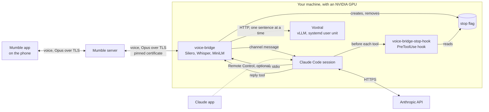
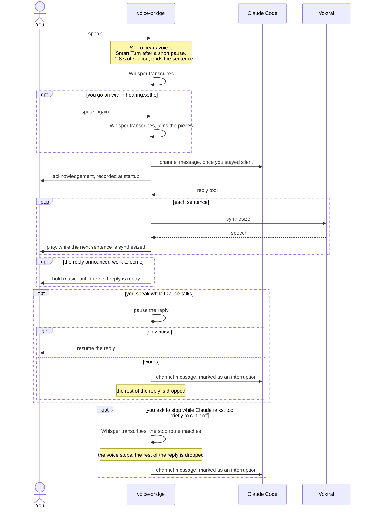
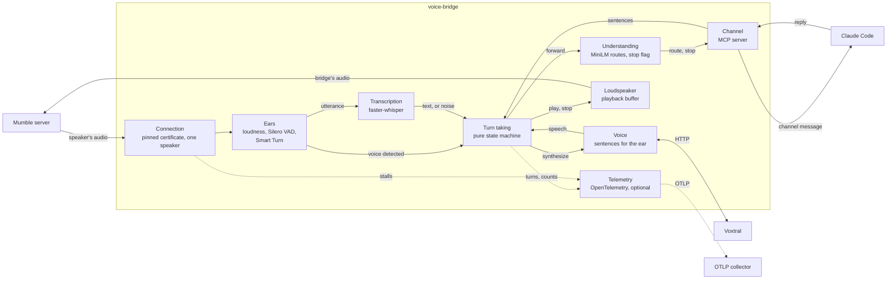

# voice-bridge

Talk to a [Claude Code](https://code.claude.com) session from your phone, hands-free and without looking at a screen. You speak in a Mumble app; the bridge transcribes what you say, hands it to Claude Code as a [channel](https://code.claude.com/docs/en/channels-reference) message, and reads Claude's replies back into your headset. Everything but the Claude model itself runs on your own machines.

## How it works



1. **Your Mumble app** sends your voice to a Mumble server.
2. **The bridge** listens to one person only: the user whose client certificate matches `speaker_certificate_hash`. A sound counts as voice when it is loud enough and [Silero VAD](https://github.com/snakers4/silero-vad) recognises speech in it, so a loud noise alone is neither transcribed nor taken for an interruption. About 0.8 s of silence ends a sentence; with `hearing.smart_turn` on, [Smart Turn](https://github.com/pipecat-ai/smart-turn) judges from the audio after a 0.2 s pause whether you have finished: it ends the sentence there when you have, and waits up to 2 s of silence when you have not.
3. **Whisper**, through [faster-whisper](https://github.com/SYSTRAN/faster-whisper) on the GPU, transcribes the sentence.
4. **The `voice` channel** pushes the text into the Claude Code session once you have kept silent for `hearing.settle` since the end of your voice, 1.2 s by default: speaking again within it holds the words back, and the sentences said with pauses reach Claude as one message, so Claude neither hears nor answers half a thought ([ADR-012](docs/decisions/ADR-012-words-wait-for-the-speakers-silence-before-reaching-claude.md)). With them, the bridge plays a short acknowledgement in Claude's voice, without waiting for Claude: none if Claude is still voicing or saying a reply, or if one already played since Claude last replied, otherwise one suited to what you said: a small multilingual model, MiniLM, turns your words into a vector of their meaning and compares it with the example sentences of a dozen routes set in one TOML file per language in [`languages/`](src/voice_bridge/configuration/languages), such as a request, a question, a reported problem, an unfinished sentence or a stop; the closest route above its threshold gives one of its four to eight sentences, a neutral one plays when no route is close enough, and the same one never plays twice in a row ([ADR-010](docs/decisions/ADR-010-semantic-routing-chooses-the-acknowledgement-and-detects-a-stop.md)). The sentences are synthesized once, when Voxtral is ready, kept in memory, and cached on disk under `cache_directory`, so later starts do not voice them again. The acknowledgement is chosen as your words are pushed, and they reach Claude with it in an `acknowledgement` attribute, so the instructions tell Claude not to acknowledge a second time.
   When your words ask to stop, such as « stop », « laisse tomber » or « ne fais pas ça », the bridge creates the file `understanding.stop_flag`, and the next sentence that does not ask to stop removes it. While it exists, `voice-bridge-stop-hook`, a `PreToolUse` hook the launcher registers, refuses Claude every tool but `reply` and `TaskStop`, so Claude stops from its next tool call; a tool already running still runs to its end.
   With `hold_music.file` set, music fills the wait while Claude works on what it announced: when Claude calls `reply` with `working` set to true, the music starts `hold_music.delay`, 2 s by default, after that sentence ends, stops when the first sentence of the next reply is ready to play or when you speak, comes back after another wait if you spoke, and picks up the track where it left off, looping at its end. The acknowledgement alone brings no music.
5. **Claude** answers with the `reply` tool, and **[Voxtral](https://huggingface.co/mistralai/Voxtral-4B-TTS-2603)** speaks the answer, sentence by sentence, while the next ones are synthesized.

Speaking while Claude talks cuts its voice: the bridge pauses the reply. If what interrupted was only noise, the reply resumes; if you said something, the rest of the reply is dropped and your words reach Claude marked as an interruption. A reply you have not heard a sound of yet is not cut: it waits for the end of your words and plays after them. A word as short as « stop » holds less voice than `hearing.barge_in`, so it does not cut Claude off as you say it: once transcribed and understood as a stop, it cuts the voice itself and drops the rest of the reply. Claude's work in progress goes on either way.

Saying the session is over, in your own words, ends it: Claude calls the `end_session` tool with a goodbye, asking you to confirm when in doubt; the bridge says the goodbye after any reply still to come, then sends SIGTERM to Claude Code, whose process ID `claude-voice.sh` passes as `VOICE_BRIDGE_CLAUDE_PID`, and the bridge ends with it. Speaking over the goodbye keeps the session going. `claude-voice.sh --continue` resumes the conversation later ([ADR-011](docs/decisions/ADR-011-a-goodbye-ends-claude-code-with-sigterm.md)).



## Requirements

- Linux with an NVIDIA GPU able to hold Voxtral and Whisper together, about 14 GB of video memory.
- [uv](https://docs.astral.sh/uv/). It brings Python 3.14 and the CUDA libraries the project needs.
- A Mumble server, version 1.5 or later. Voice reaches the bridge through the server's TLS connection, which [pymumble-rev](https://github.com/AidenOfficial/PyMumble) requires.
- A Mumble app on the phone, such as [Mumla](https://mumla-app.gitlab.io/) on Android.
- Claude Code with channels enabled. Channels are a research preview: a channel outside Anthropic's allowlist loads with `--dangerously-load-development-channels`, which the launcher passes.
- [Graphviz](https://graphviz.org/), only to draw the architecture diagram.

## Install

```bash
uv sync
```

`uv sync --extra otel` adds OpenTelemetry, to [export traces, metrics and the log](#export-traces-metrics-and-the-log) to a collector.

## Configure

The bridge reads `~/.config/voice-bridge/config.toml`; `--config` points at another file. Variables named `VOICE_BRIDGE_<KEY>`, or `VOICE_BRIDGE_<SECTION>__<KEY>` for a key inside a section, override the file. An unknown key or a missing value stops the bridge at start. Start from [`config.example.toml`](config.example.toml) and keep the file readable by you only, since it holds the server password:

```bash
mkdir -p ~/.config/voice-bridge
cp config.example.toml ~/.config/voice-bridge/config.toml
chmod 600 ~/.config/voice-bridge/config.toml
```

| Key | Default | Meaning |
|---|---|---|
| `language` | `en` | `ar`, `de`, `en`, `es`, `fr`, `hi`, `it`, `nl` or `pt`: the language Whisper transcribes, the default voice, the greeting, the acknowledgements and the default instructions |
| `mumble.host`, `mumble.port` | required, `64738` | The Mumble server |
| `mumble.password` | required | The server password |
| `mumble.username` | `claude` | The bridge's name on the server |
| `mumble.server_certificate` | required | The server certificate the bridge trusts; see below |
| `mumble.speaker_certificate_hash` | required | The certificate hash of the one person the bridge listens to; see below |
| `speech.url` | `http://127.0.0.1:8123` | The speech server: Voxtral by default, or any server with the OpenAI speech API (`POST /v1/audio/speech`, WAV out) |
| `speech.model` | `mistralai/Voxtral-4B-TTS-2603` | The model the speech server is asked for |
| `speech.voice` | the language's | A voice of the speech server, such as Voxtral's `neutral_female` or `fr_female` |
| `speech.gain` | `1.0` | Loudness of the speech; values above 1 raise it without clipping |
| `speech.health` | `/health` | The route the bridge polls at start until the speech server answers; empty for a server without one, which is then taken as ready |
| `whisper.model`, `whisper.device`, `whisper.compute_type` | `large-v3-turbo`, `auto`, `default` | The faster-whisper model and how it runs |
| `hearing.smart_turn` | `false` | Ends a sentence when [Smart Turn](https://github.com/pipecat-ai/smart-turn) judges, after a short pause, that you have finished; the 0.8 s silence stays as a fallback. The model, 9 MB, is downloaded from Hugging Face on first start |
| `hearing.short_pause`, `hearing.turn_threshold` | `0.2`, `0.5` | The pause after which Smart Turn is asked, shorter than `hearing.silence`, and the probability above which the turn counts as finished |
| `hearing.unfinished_silence` | `2.0` | With `hearing.smart_turn`, the silence that ends a sentence Smart Turn judged unfinished, longer than `hearing.silence`, so a pause mid-thought does not cut it |
| `hearing.settle` | `1.2` | The silence after the end of your voice before your words reach Claude with their acknowledgement; speaking again within it holds them back and joins the next words to them, so a pause mid-thought is neither answered nor sent in pieces. Every reply comes that much later |
| `hearing.*` | see [`settings.py`](src/voice_bridge/configuration/settings.py) | Thresholds and durations of voice detection; the start stops when `shortest_voice` exceeds `barge_in`, since an interruption could then be dismissed as too short |
| `hold_music.file` | none | An audio file, in any format FFmpeg reads, played while you wait for a reply; decoded once at startup |
| `hold_music.delay`, `hold_music.volume` | `2.0`, `0.3` | How long after the end of an announcement of work the music starts, and its loudness, below the voice's |
| `understanding.threshold` | `0.5` | The cosine similarity to its closest example a sentence needs to take a route; the stop route asks 0.75, set in each language's TOML file in [`languages/`](src/voice_bridge/configuration/languages). The model, 220 MB, is downloaded from Hugging Face on first start |
| `understanding.stop_flag` | `$XDG_RUNTIME_DIR/voice-bridge/stop` | The file whose presence makes `voice-bridge-stop-hook` refuse Claude's tools after a stop |
| `claude_pid` | none | The Claude Code process the bridge ends after a goodbye; `claude-voice.sh` sets it through `VOICE_BRIDGE_CLAUDE_PID`. Without it, `end_session` says goodbye and leaves the session open |
| `instructions_file` | `~/.config/voice-bridge/instructions.md` | What Claude is told about the channel; when the file is missing, the language's defaults from [`languages/`](src/voice_bridge/configuration/languages) apply |
| `cache_directory` | `~/.cache/voice-bridge` | Where the voiced acknowledgements are kept between starts; deleting it voices them again |
| `log_file` | `~/.local/state/voice-bridge/log/voice-bridge.log` | The bridge's log, rotated at 5 MB |
| `logging` | none | Where the bridge's log goes, its levels and its format, in the standard library's [`dictConfig`](https://docs.python.org/3/library/logging.config.html#logging-config-dictschema) schema; see below. Without it, the log goes to stderr and to `log_file`. The recorder and the rehearsal keep their own files |

### Send the log elsewhere

The `[logging]` section replaces the default log with any setup of Python's [`logging`](https://docs.python.org/3/library/logging.html): loggers pick what is logged and at which level, handlers where it goes, formatters what a line looks like. `version = 1` and `disable_existing_loggers = false` are set for you, so the bridge's loggers, created before the section applies, keep logging. A section `dictConfig` refuses stops the bridge at start with `invalid [logging] section:` and the reason.

To the systemd journal, through the `/dev/log` socket it listens on, with `httpx` quieted, then read it with `journalctl -t voice-bridge -f`:

```toml
[logging.formatters.journal]
format = "%(levelname)s %(name)s %(message)s"

[logging.handlers.journal]
class = "logging.handlers.SysLogHandler"
address = "/dev/log"
formatter = "journal"
"." = { ident = "voice-bridge: " }

[logging.loggers.httpx]
level = "WARNING"

[logging.root]
level = "INFO"
handlers = ["journal"]
```

To a syslog server on the network, a handler with `address = ["logs.example.org", 514]` sends over UDP; add `socktype = "ext://socket.SOCK_STREAM"` for TCP, which connects at start, so an unreachable server stops the bridge. To keep the file as well, add a `logging.handlers.RotatingFileHandler` handler with its `filename` and list both handlers in `root`.

To an OpenTelemetry collector, see below: the log joins the traces and metrics there, and the section's handlers keep writing it.

### Export traces, metrics and the log

Nothing leaves the machine by default. With the `otel` extra installed and an OTLP endpoint set, the bridge exports, to the collector of your choice:

- **one trace per turn**: a `turn` span from the end of your voice until your next words reach Claude, with a span for each step: `transcription`, `settle` before your words are pushed, `claude` until its first reply, each `synthesis` or `failed synthesis`, and each `playback`, cut where you interrupted; the turn tells whether it was `interrupted`;
- **metrics**: `voice_bridge.turn.duration` and `voice_bridge.step.duration` by step, in seconds; `voice_bridge.events`, the interruptions and the sounds dismissed as too short; `voice_bridge.audio.stall.duration`, the gaps in your audio reaching the bridge;
- **the log**, alongside the handlers of `[logging]` or the default log, which keep writing.

The bridge exports only when `OTEL_EXPORTER_OTLP_ENDPOINT`, or `OTEL_EXPORTER_OTLP_TRACES_ENDPOINT` or `OTEL_EXPORTER_OTLP_METRICS_ENDPOINT`, is set, and imports OpenTelemetry only then ([ADR-013](docs/decisions/ADR-013-telemetry-behind-a-port-and-the-otel-extra.md)). The SDK, the exporters and the log handler come from [zero-code instrumentation](https://opentelemetry.io/docs/zero-code/python/): in `scripts/claude-voice.sh`, run `opentelemetry-instrument voice-bridge-channel` instead of `voice-bridge-channel`, with the endpoint and `OTEL_SERVICE_NAME=voice-bridge` in the environment.


### Add a language

The bridge speaks Arabic, Dutch, English, French, German, Hindi, Italian, Portuguese and Spanish, the nine languages Voxtral has voices for. Each one is two files in [`languages/`](src/voice_bridge/configuration/languages), named after its ISO 639-1 code:

- `<code>.toml`: the Whisper language code, the default voice, the greeting, the tool descriptions, the Whisper hallucinations to drop, and the twelve routes with their examples, acknowledgements and the stop threshold. A test asks for at least 15 examples per route.
- `<code>.md`: the instructions Claude is given, when the user has no `instructions_file`.

To add one:

1. Add its code to `Language` in [`settings.py`](src/voice_bridge/configuration/settings.py) and to `LANGUAGES` in `tests/configuration/test_language.py`.
2. Copy `en.toml` and `en.md` to `<code>.toml` and `<code>.md` and translate them.
3. Add `tests/configuration/test_language_<code>.py`, after the other ones, with real sentences of that language for the routes and for words about stopping that must not stop.
4. Add `<code>.toml`, `<code>.md` and `*_<code>.py` to `[tool.typos.type.localized]` in `pyproject.toml`, so typos checks their names but not their content.
5. Try it with someone who speaks it, read the `understood '…' as <route> (<score>)` lines, and adjust the examples and the stop threshold.

Sentences are cut on Western punctuation, the Arabic question mark, the Devanagari full stop and the CJK marks, so Chinese and Japanese replies are already voiced one sentence at a time. A language Voxtral does not voice needs another speech server with the OpenAI speech API, such as [Kokoro-FastAPI](https://github.com/remsky/Kokoro-FastAPI): point `speech.url`, `speech.model` and `speech.voice` at it, and set `speech.health` to its health route, or leave it empty if it has none.

### The server certificate

The bridge trusts one certificate only: the server's, pinned like a known SSH host. It refuses anything older than TLS 1.2, and skips the host name check that a self-signed Murmur certificate cannot pass. Export the certificate once, and again whenever the server generates a new one:

```bash
openssl s_client -connect voice.example.org:64738 </dev/null 2>/dev/null \
  | openssl x509 -outform PEM > ~/.config/voice-bridge/server.pem
```

### The speaker's certificate

A Mumble user name proves nothing: anyone with the server password can take it. The bridge only listens to the client certificate your Mumble app holds. To find its hash, start the bridge with any value, connect from your phone and say something: the bridge ignores you and logs the hash to copy into `speaker_certificate_hash`.

```
ignored a transmission from 'you', certificate hash 6f0b58787b96ff978ba512c74a1c3ca4aabab441
```

## Run

From the folder you want Claude Code to work in:

```bash
~/path/to/voice-bridge/scripts/claude-voice.sh
```

The launcher starts Voxtral when it is not running, which takes a few minutes the first time, then starts Claude Code with the `voice` channel. Arguments go to Claude Code, so `--resume <session>` works.

1. **Accept the warning.** Claude Code shows a full-screen warning about development channels at every start: choose *I am using this for local development*. Below the banner, `Channels (experimental) messages from server:voice` confirms the channel is registered.
2. **Connect from the phone.** Once Whisper is loaded and Voxtral answers, you hear the greeting and the bridge's user appears in the channel.
3. **Optionally, turn on Remote Control** with `/remote-control`. The voice does not need it, but it lets you see the session and answer permission prompts from the Claude app; without it, Claude waits silently when it needs a permission.

While it runs:

- Wear headphones: otherwise the microphone hears Claude and Claude cuts itself off.
- Keep the machine awake; a laptop closing its lid goes to sleep.
- Run one voice session at a time: two bridges with the same name on the server push each other off.

To stop, leave Claude Code with `/exit`, then free the GPU from Voxtral:

```bash
scripts/voxtral.sh stop
```

`scripts/voxtral.sh` also takes `start`, `status` and `logs`; it runs Voxtral with [vLLM](https://docs.vllm.ai) as a systemd user unit.

## Diagnose

The log tells every step of a turn, timestamped to the millisecond: what was heard with Whisper's scores per segment, each end-of-turn decision of Smart Turn with its probability and the time it saved, what was forwarded to Claude, which acknowledgement was played, when its reply arrived, how long each sentence took to synthesize, when playback started, how fast an interruption stopped it, every stall of more than 100 ms in the audio reaching the bridge with how much audio arrived in the 200 ms after it, about 1x real time after a pause of the client and well above after a network stall, and every user joining, leaving or changing channel on the Mumble server with their session, the speaker marked as such: a disconnection and a reconnection of the speaker leave two lines, the second with a new session.

```bash
tail -f ~/.local/state/voice-bridge/log/voice-bridge.log
```

Two more commands help test the voice path without Claude:

- `scripts/with-cuda.sh uv run voice-bridge-rehearsal` joins the server as `rehearsal` and repeats everything you say: hearing, transcription, synthesis and interruptions, without a Claude Code session.
- `uv run voice-bridge-recorder` joins as `recorder` and records the bridge's voice as the server sends it: one WAV per answer in `~/.local/state/voice-bridge/log/recordings/`, and for each one its length, packets, lost audio and longest gap in `recorder.log`. A recording that is complete while the phone heard gaps puts the loss between the server and the phone.

| Symptom | Where to look |
|---|---|
| No greeting | `scripts/voxtral.sh status`, then the log |
| The wrong acknowledgement, or a stop missed or wrongly taken | Lines `understood '…' as <route> (<score>)`: add the sentence to the right route's examples in the language's TOML file in [`languages/`](src/voice_bridge/configuration/languages), or adjust `understanding.threshold` and the stop route's threshold |
| Claude's tools are refused after a stop | `stop asked` and `stop lifted` in the log: any sentence that does not ask to stop lifts it |
| No acknowledgement after you speak | `acknowledgements ready` in the log: until Voxtral has voiced them, the bridge has none to play |
| `server:voice · no MCP server configured with that name` | The session was not started with `scripts/claude-voice.sh` |
| The bridge hears you but Claude never answers | `/mcp` in the session, then the log for `forwarded` lines |
| Nothing you say appears in the log | Look for `ignored a transmission`: the certificate hash differs from `speaker_certificate_hash` |
| `certificate verify failed` | The server has a new certificate: export it again |
| A slow turn, without knowing which step took the time | With [telemetry exported](#export-traces-metrics-and-the-log), the turn's trace shows each step; without it, the log's timing lines tell the same, one by one |
| Claude's voice cuts itself off | Lines `interrupted` with no one speaking: use headphones, or raise `hearing.volume_threshold` |
| Claude answers half a sentence, or its acknowledgement plays while you are still thinking | Lines `joined N pieces said with pauses` show the pauses `hearing.settle` already covered; a `forwarded` line followed within seconds by words that continue it calls for a longer `hearing.settle` |
| With `hearing.smart_turn`, sentences are cut while you pause mid-thought | Lines `turn finished (p=…)` before the cut: raise `hearing.turn_threshold` or `hearing.short_pause`; lines `turn not finished (p=…)` before the cut: raise `hearing.unfinished_silence`; `end of turn judged in … ms` tells what each decision costs |
| An invented sentence arrives, such as "Thank you." | Read its scores in the log; known Whisper hallucinations are filtered per language, as listed in its TOML file in [`languages/`](src/voice_bridge/configuration/languages) |

## Architecture

Inside the bridge, one task per stage passes events along; turn taking decides, the others carry out:



The code is split into features, on top of shared libraries; entry points only wire them together.

```
src/voice_bridge/
  features/
    hearing/       detect utterances, filter hallucinations, transcribe (Silero, Whisper)
    speaking/      sentences written for the ear, synthesis (OpenAI speech API, Voxtral by default)
    conversation/  turn taking, interruptions, turn traces, the Claude channel (MCP)
    understanding/ routes by meaning for acknowledgements and stops (MiniLM on ONNX Runtime)
    recording/     the diagnostic recorder
  libraries/
    audio/         PCM and WAV with numpy and soxr
    mumble/        pinned connection, speaker audio, loudspeaker (pymumble-rev)
  configuration/   settings (pydantic-settings), languages, default instructions
  entrypoints/     voice-bridge-channel, voice-bridge-rehearsal, voice-bridge-recorder, voice-bridge-stop-hook
```

Each feature holds code shared by its abilities, and each ability is a vertical slice:

```
features/<feature>/
  domain/                pure code shared by the abilities
  implementation/        adapters shared by several abilities, none today
  abilities/<ability>/
    domain/              the ability's ports, as typing.Protocol, and its pure logic
    implementation/      the shell that carries out the domain's decisions, and the adapters only this ability uses
```

Turn taking is a pure state machine, `step(state, event) -> (state, commands)`, in [`turn_taking.py`](src/voice_bridge/features/conversation/domain/turn_taking.py). Its rules are written as Gherkin scenarios in [`turn_taking.feature`](tests/features/conversation/domain/turn_taking.feature), run by [pytest-bdd](https://pytest-bdd.readthedocs.io). Seven rules govern the imports:

1. Features never import each other; only the entry points assemble them.
2. An ability never imports another ability.
3. A feature's `domain` and `implementation` never import an ability.
4. A feature's `domain` imports only the standard library and the language extensions listed in `LANGUAGE_EXTENSIONS`, none today.
5. An ability's `domain` imports only what rule 4 allows, plus its feature's `domain`.
6. An ability's `implementation` imports only its own ability, its feature's `domain` and `implementation`, `voice_bridge.libraries` and outside packages.
7. Only entry points import an ability's `implementation`; a feature's `implementation` is also imported by the implementations of its abilities.

[import-linter](https://import-linter.readthedocs.io) contracts in [`pyproject.toml`](pyproject.toml) check rules 1, 2, 3 and 7, and keep libraries below features; the allow lists of rules 4, 5 and 6 are checked by [`tests/architecture`](tests/architecture) on the import graph built by [grimp](https://grimp.readthedocs.io). No `__init__.py` re-exports an ability: entry points import each ability's module directly.

The diagram of the dependencies between these parts is drawn from the imports, never committed, so it cannot fall out of date:

```bash
uv run pydeps src/voice_bridge
```

It writes `docs/architecture.svg`.

The decisions behind this design, and the alternatives they set aside, are recorded in [`docs/decisions/`](docs/decisions).

## Develop

```bash
uv sync
uv run prek install
```

[prek](https://prek.j178.dev) then checks every commit with Ruff, basedpyright in its strictest mode, the import-linter contracts, deptry, the tests with full branch coverage and a time limit, the lockfile, ShellCheck, gitleaks and the spelling with typos; the hygiene of every text file (final newline, trailing whitespace, merge conflict markers, large files, TOML and YAML syntax) with pre-commit-hooks, `pyproject.toml` with validate-pyproject, and the workflows with actionlint and zizmor; every commit message against [Conventional Commits](https://www.conventionalcommits.org) with commitizen; and the dependencies with `uv audit` before every push. The CI runs the same checks on every pull request.

```bash
uv run prek run --all-files
uv run pytest
uv run mutmut run
```

Besides example tests, [Hypothesis](https://hypothesis.readthedocs.io) checks properties of the domains over generated cases, and [mutmut](https://mutmut.readthedocs.io) injects faults into the domains to check the tests catch them; a weekly workflow lists the surviving mutants in its summary and fails if any survives. A line whose mutants change no behaviour, and that no test or simpler code can get rid of, carries `# pragma: no mutate`, alone on its line. [Renovate](https://docs.renovatebot.com) keeps the dependencies, the actions and the actionlint hook up to date.

[`CONTRIBUTING.md`](CONTRIBUTING.md) explains how to propose a change, and [`SECURITY.md`](SECURITY.md) how to report a vulnerability privately.

### Merging

Every change goes through a pull request on a branch named after its Conventional Commits type, such as `feat/…` or `fix/…`. Pull requests are merged by fast-forward from a local clone rather than with GitHub's button: GitHub's rebase merge recreates the commits without their signatures, while `main` requires signed commits, a linear history and both CI jobs green.

```bash
git switch feat/something
git rebase main
git push --force-with-lease
git push origin feat/something:main
```

The last command succeeds once the checks have passed on the rebased branch; GitHub then marks the pull request as merged.

## Limits

- Permissions are not answered by voice.
- Interrupting Claude cuts its voice, not its task; asking it to stop refuses its next tools, not the one already running.
- Speaking over an acknowledgement does not cut it, and the routes read only the words: about a third of real sentences got another kind than a person would pick in the measurements of [ADR-010](docs/decisions/ADR-010-semantic-routing-chooses-the-acknowledgement-and-detects-a-stop.md), and a sentence that quotes or denies a stop, such as « je n'ai pas dit stop », comes close to the stop route.
- Voice reaches the bridge over TCP only, the one transport pymumble-rev implements, so a lossy mobile link can delay it.
- Channels are a Claude Code research preview: the bridge serves them on the MCP handshake protocol, since Claude Code does not deliver channel messages on the 2026-07-28 protocol.
- Voxtral's licence, [CC BY-NC 4.0](https://huggingface.co/mistralai/Voxtral-4B-TTS-2603), forbids commercial use.

## License

[MIT](LICENSE)
